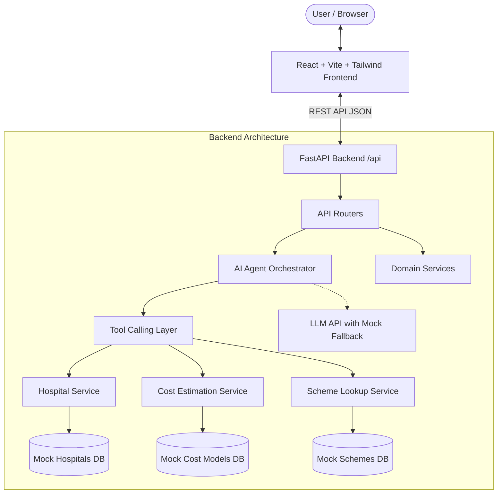

# Architecture: Healthcare Cost & Care Navigation Agent

## System Overview

## Safety Guardrails
1. **Emergency Interception**: Natural language queries containing emergency keywords ("chest pain", "breathing difficulty", "severe bleeding", "unconscious", "stroke") are immediately intercepted. The agent provides urgent direct actions (call 108/112, rush to nearest ER) rather than a delayed search loop.
2. **No Medical Prescription / Diagnosis**: The system explicitly provides navigation, hospital discovery, cost ranges, and scheme eligibility assistance only.
3. **Appointment Booking Safety**: All bookings are simulated (`is_simulated: true`) and explicitly require user confirmation (`user_confirmed: true`). Success is never falsely reported as an active hospital clinical slot.
4. **Data Mode Transparency**: Every record and estimate is tagged as `"mock"`, `"estimated"`, or `"verified"`.

## Modules
- `frontend/`: Single Page Application with responsive Tailwind dashboard, interactive natural language chat, hospital directory filters, procedure cost calculator, government scheme explorer, and simulated booking dialog.
- `backend/app/`: FastAPI server with clean domain separation (`api`, `agent`, `services`, `models`, `data`). Fully runs offline in `mock` mode even without a third-party LLM key.
